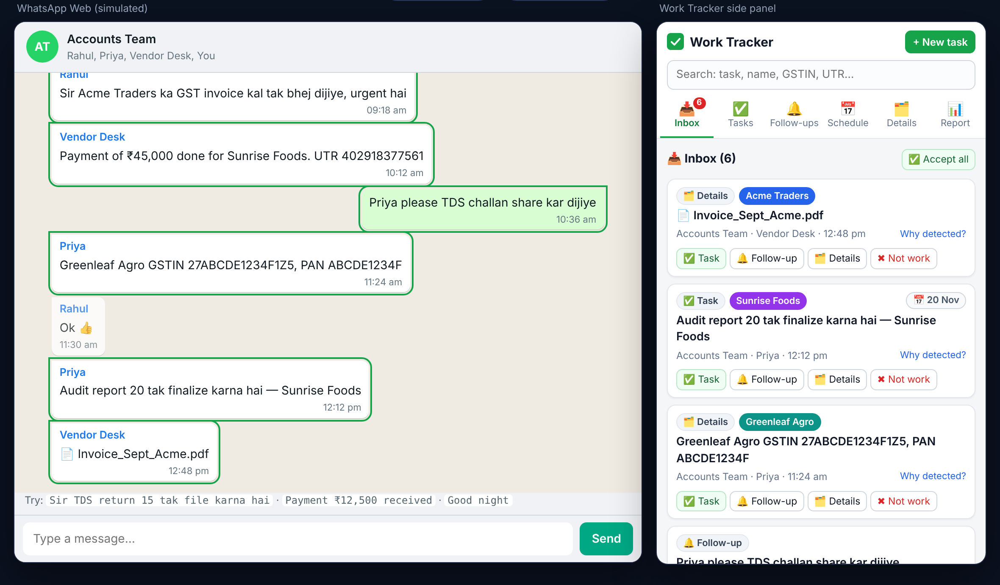
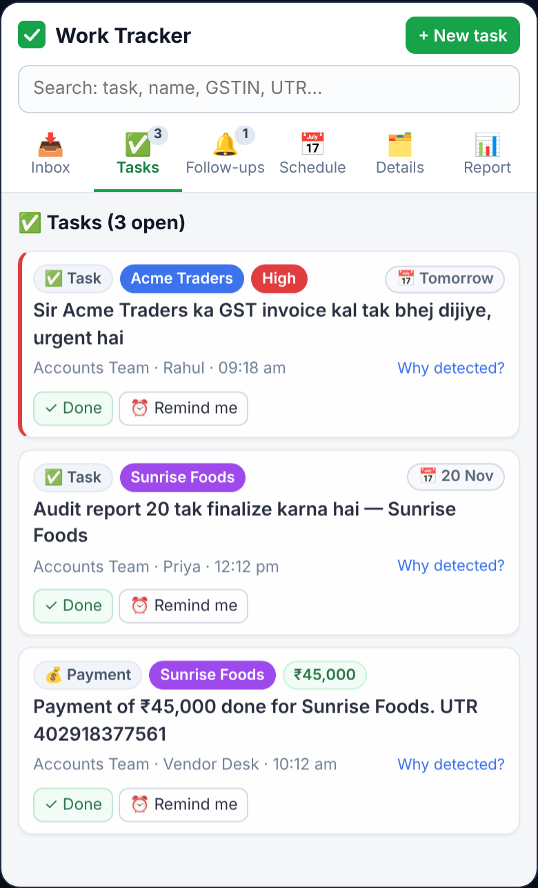
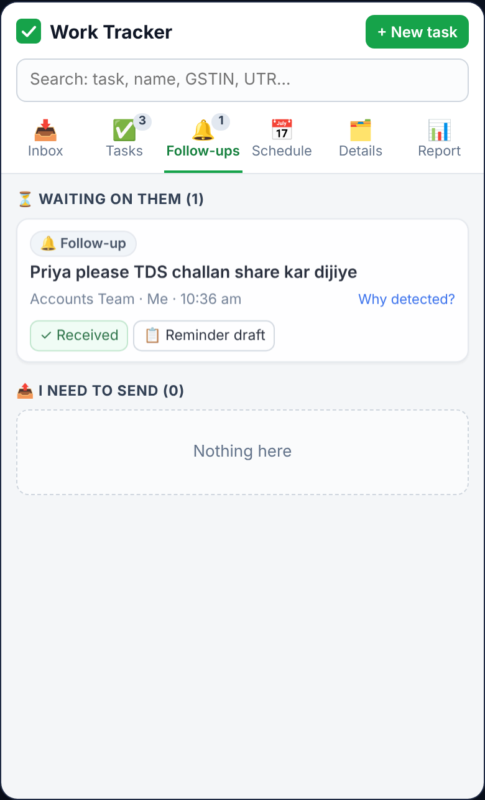
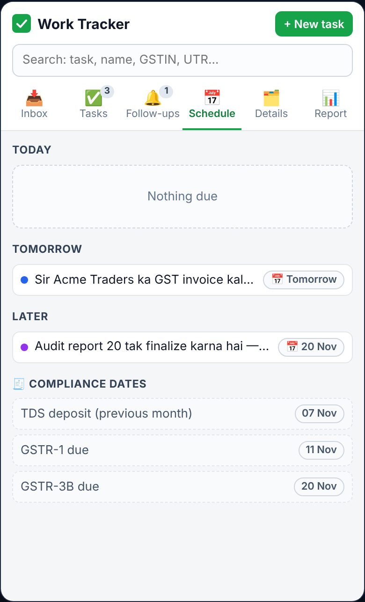
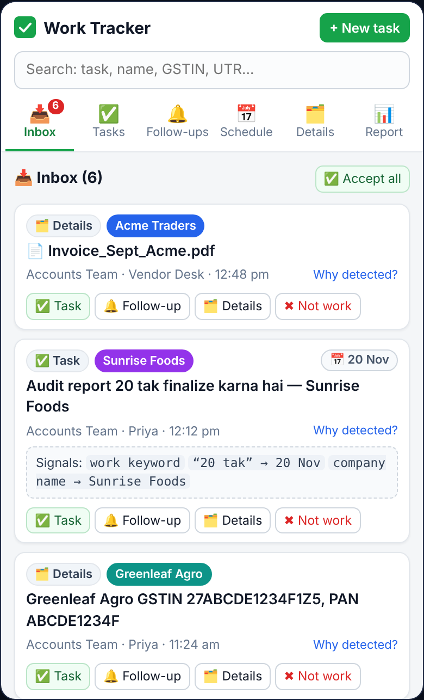
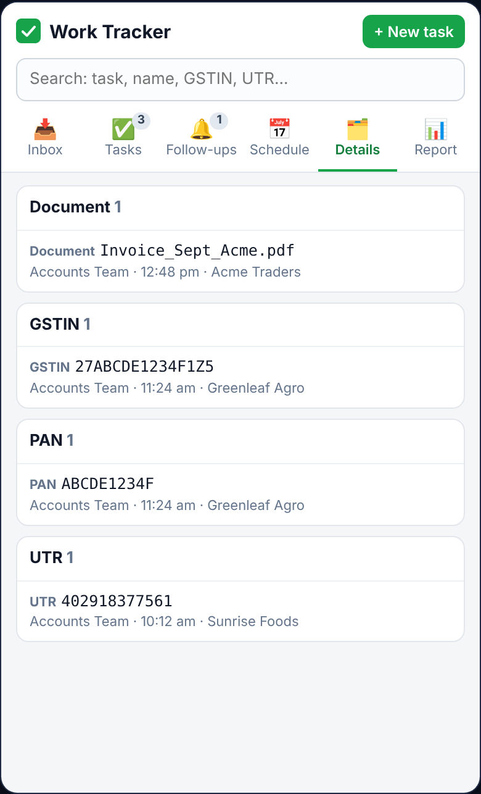
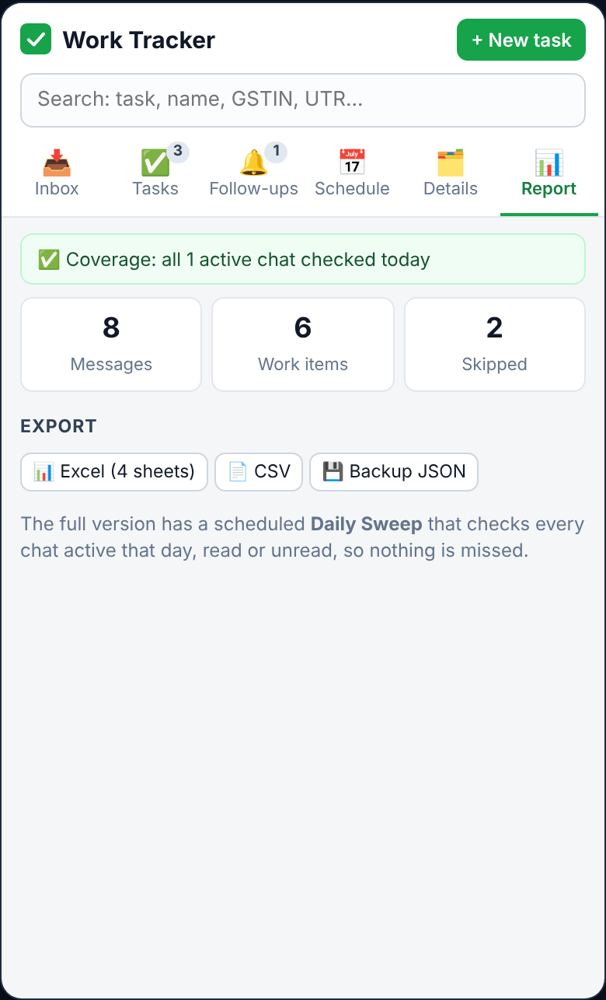

# WhatsApp Work Tracker

**Your WhatsApp is full of work. This turns it into a to-do list, automatically.**

A Chrome extension that reads your work messages on WhatsApp Web and turns them into
**tasks, follow-ups, payments and reminders**, with due dates and company tags.
No server, no subscription, no AI bills. **100% offline.**

[**▶ Try the live demo**](https://marufayesha.github.io/whatsapp-work-tracker/) · [⭐ Star to get notified](#-full-release-coming-soon)

---

Screenshots are from the live demo. All chats, names, companies and numbers are made-up sample data.

## 😩 The problem

If you run a business, manage accounts or handle clients in India, a lot of real work happens on WhatsApp:

> *“Sir GST invoice kal tak bhej dijiye”* · *“Payment ₹45,000 done, UTR 4029…”* · *“Audit report 20 tak finalize karna hai”*

These messages get buried under “Good morning 🌞” forwards. Deadlines slip, payments go unconfirmed and follow-ups are forgotten.

## ✨ The solution

Keep WhatsApp Web open and read your chats as usual. **Work Tracker** works quietly in the side panel:

| | Feature | What it does |
|---|---|---|
| 📥 | **Smart Inbox** | Detects work messages automatically and lets you sort each one in a single tap: Task, Follow-up, Details or Not work |
| 📅 | **Understands Hinglish dates** | Turns “kal tak”, “20 tak”, “Monday ko” and “EOD” into real due dates, counted from the day the message was sent |
| 🔔 | **Follow-ups both ways** | Tracks what others owe you and what you owe them. Includes reminders, snooze and auto-detection when the reply arrives |
| 🗂️ | **Details vault** | Pulls GSTIN, PAN, IFSC, bank details, UTR, amounts and documents into one searchable place, with click-to-copy |
| 🏢 | **Multi-company tags** | Handles several businesses and tags every task to the right one |
| 🧾 | **Compliance calendar** | Shows GST, TDS, ITR and ROC due dates right next to your tasks |
| 📊 | **Daily Sweep + Report** | Checks every chat active today, read or unread, so nothing slips through |
| 📤 | **Export** | Excel (multi-sheet), CSV and JSON backup/restore |
| 🔒 | **Private by design** | Read-only: it never sends or clicks on its own. OTPs are never stored, passwords are redacted and Aadhaar is masked. No cloud. |

## 📸 Screenshots

| Tasks | Follow-ups | Schedule |
|---|---|---|
|  |  |  |

| Why was it detected? | Details vault | Daily report |
|---|---|---|
|  |  |  |

## 🎮 Try it yourself

Open the **[live demo](https://marufayesha.github.io/whatsapp-work-tracker/)** and type a message in the simulated WhatsApp chat. Some to try:

- `Sir TDS return 15 tak file karna hai`
- `Payment ₹12,500 received`
- `Good night` (watch it get ignored 😉)

> The demo runs in your browser with sample data and a simplified matcher made just for this page.
> The real extension uses a much more complete, fully tested detection engine.

## 🛠️ Built with

- Chrome Extension **Manifest V3** (service worker + side panel)
- Plain **JavaScript**, with no framework and no build step
- **IndexedDB** (Dexie) for local storage and **SheetJS** for Excel export
- Rules-based detection engine for **Hinglish + English + Hindi**, covered by **161 automated tests**

## 🗺️ Roadmap

- [x] Message reader, detection engine and Smart Inbox
- [x] Tasks, follow-ups, reminders and daily digest
- [x] Schedule + compliance calendar
- [x] Details vault, company tags and Excel/CSV export
- [x] Daily Sweep + Daily Report
- [ ] Public release of the source code
- [ ] Optional AI mode (bring your own API key)
- [ ] Invoice photo OCR
- [ ] Google Calendar export

## 🚀 Full release coming soon

The extension works and is in private use. **The full source code will be published here soon.**

- ⭐ **Star this repo** to get notified when it drops
- 👀 **Watch → Custom → Releases** to get an alert
- 💬 Open an [issue](https://github.com/Marufayesha/whatsapp-work-tracker/issues) to tell me what you'd use it for, or to ask for early access

---

Not affiliated with, endorsed by or connected to WhatsApp or Meta. “WhatsApp” is a trademark of its owner.
© 2026 Marufayesha. All rights reserved.
